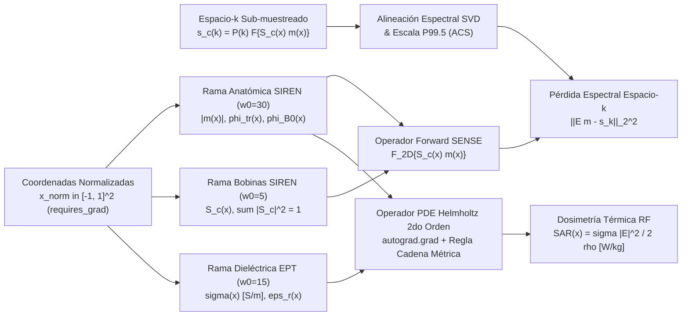

# Decoupled MRI-PINN: Simultaneous Multi-Coil $k$-Space Reconstruction, Quantitative Helmholtz-EPT & Local RF Thermal Dosimetry ($\text{SAR}$)

[](LICENSE)
[](https://pytorch.org/)
[](https://fastapi.tiangolo.com/)
[](https://react.dev/)

Plataforma computacional en PyTorch/CUDA y estación interactiva PACS para **reconstrucción simultánea en espacio-$k$ multi-bobina, tomografía de propiedades eléctricas (MR-EPT) y dosimetría térmica de radiofrecuencia ($\text{SAR}$)** mediante redes neuronales informadas por la física (PINNs) con separación armónica de fase.

---

## 1. Resumen Ejecutivo y Aporte Científico

**Decoupled MRI-PINN** es una arquitectura auto-supervisada (*zero-shot*, sin requerir bases de datos previas de entrenamiento) que resuelve de forma acoplada tres problemas inversos fundamentales de la Física Médica en Resonancia Magnética en **menos de $4\text{ segundos}$** sobre una GPU de consumo (NVIDIA GeForce RTX 4060 Ti):

1. **Reconstrucción Inversa Paralela en Espacio-$k$ Multi-Bobina ($\mathcal{E}$ Differentiable SENSE):** Recupera la magnitud anatómica $|m(\mathbf{x})|$ y la fase compleja libre de aliasing a partir de apenas el **$12.5\%\text{--}25.0\%$** del espacio-$k$ ($R = 4\times$ y $R = 8\times$) con alineación espectral automática de fase entre antenas vía descomposición en autovalores (SVD) sobre la región central ACS.
2. **Tomografía de Propiedades Eléctricas (MR-EPT) Inmune a *Phase-Wrapping* ($1.5\text{ T}$, $3.0\text{ T}$ y $7.0\text{ T}$):** Evalúa analíticamente el Laplaciano espacial de segundo orden ($\nabla^2 B_1^+(\mathbf{x})$) mediante diferenciación automática exacta (`torch.autograd.grad`) sobre una representación neuronal implícita periódica (**SIREN**), acoplada a un desenvolvimiento continuo en $\mathbb{S}^1$ anclado en el anillo cortical periférico y a una proyección ortogonal armónica ($\nabla^2 \phi_{B_0}(\mathbf{x}) = 0$) que suprime las ondas estacionarias de salto $2\pi$ a $7.0\text{ T}$.
3. **Dosimetría Térmica Local de Radiofrecuencia ($\text{SAR}(\mathbf{x})$ en $\text{W/kg}$):** Cuantifica de forma no invasiva el mapa paciente-específico de absorción electromagnética $\text{SAR}(\mathbf{x}) = \frac{\sigma(\mathbf{x})\|\mathbf{E}(\mathbf{x})\|^2}{2\rho(\mathbf{x})}$, revelando focos de calentamiento intratumoral en gliomas hiper-conductivos frente a los límites de seguridad de la norma internacional **IEC 60601-2-33**.

---

## 2. Formulación Físico-Matemática y Arquitectura



### Salvaguardas Físico-Numéricas Implementadas
- **Escalado métrico exacto sin romper el dominio de Sitzmann:** Las tres sub-redes SIREN operan estrictamente en coordenadas adimensionales $\tilde{\mathbf{x}} \in [-1, 1]^2$, transformando las derivadas analíticas al dominio físico métrico $(L_x, L_y)$ mediante la regla de la cadena:
  $$\frac{\partial u}{\partial x_{\text{m}}} = \left(\frac{2}{L_x}\right)\frac{\partial u}{\partial \tilde{x}}, \qquad \frac{\partial^2 u}{\partial x_{\text{m}}^2} = \left(\frac{2}{L_x}\right)^2\frac{\partial^2 u}{\partial \tilde{x}^2}$$
- **Estabilidad numérica en regiones de aire:** Denominador regularizado $|B_1^+(\mathbf{x})| + \epsilon$ ($\epsilon = 10^{-3}$) y máscara tisular diferenciable $W_{\text{tis}}(\mathbf{x}) = \operatorname{sigmoid}\!\left(\frac{|m(\mathbf{x})| - 0.15\max|m|}{0.02}\right)$ en [`src/physics/helmholtz_ept.py`](src/physics/helmholtz_ept.py).
- **Warm-up físico en dos etapas:** Durante las primeras $15$ épocas ($\alpha(t) = 0$) se estabilizan exclusivamente la anatomía $|m(\mathbf{x})|$, la fase $\phi(\mathbf{x})$ y las sensibilidades $S_c(\mathbf{x})$ antes de activar los residuos de segundo orden de Helmholtz ($\alpha(t) \to 1$).

---

## 3. Resultados Experimentales y Figuras a 300 DPI

### 3.1 Validación Multi-Campo ($1.5\text{ T}$, $3.0\text{ T}$, $7.0\text{ T}$) y Dosimetría Térmica $\text{SAR}(\mathbf{x})$


| Campo $B_0$ ($f_0$) | $\text{PSNR}_{\text{ZF}}$ (dB) | $\text{PSNR}_{\text{PINN}}$ (dB) | $\text{SSIM}$ | $\text{NRMSE}_{\sigma}$ | $\hat{\sigma}_{\text{ROI}}$ ($\text{GT } 1.20\text{ S/m}$) | $\text{SAR}_{\text{sano}}$ (W/kg) | $\text{SAR}_{\text{tumor}}$ (W/kg) |
| :--- | :---: | :---: | :---: | :---: | :---: | :---: | :---: |
| **$1.5\text{ T}$** ($63.87\text{ MHz}$) | $34.45$ | **$43.18$** ($+8.73$) | $0.9883$ | $0.2406$ | $1.04\text{ S/m}$ | $0.26$ | **$1.01\text{ W/kg}$** |
| **$3.0\text{ T}$** ($127.74\text{ MHz}$) | $34.30$ | **$42.35$** ($+8.04$) | $0.9751$ | **$0.2176$** | $1.04\text{ S/m}$ | $0.56$ | **$2.41\text{ W/kg}$** |
| **$7.0\text{ T}$** ($298.06\text{ MHz}$) | $33.33$ | **$41.38$** ($+8.05$) | $0.9713$ | $0.2295$ | **$1.07\text{ S/m}$** | $1.52$ | **$7.17\text{ W/kg}$** |

---

### 3.2 Prueba de Estrés a Aceleración Extrema ($R = 4\times$ vs $R = 8\times$ a $3.0\text{ T}$)


| Aceleración | Trayectoria $\mathbf{P}(\mathbf{k})$ | Datos Medidos | $\text{PSNR}_{\text{ZF}}$ (dB) | $\text{PSNR}_{\text{PINN}}$ (dB) | $\text{SSIM}$ | $\text{NRMSE}_{\sigma}$ | $\hat{\sigma}_{\text{ROI}}$ (S/m) |
| :---: | :--- | :---: | :---: | :---: | :---: | :---: | :---: |
| **$R=4\times$** | `CARTESIAN` | $25.0\%$ | $27.57$ | $29.66$ ($+2.09$) | $0.8041$ | $0.2843$ | $0.99$ |
| **$R=4\times$** | `RADIAL` | $38.2\%$ | $34.41$ | **$41.75$** ($+7.34$) | $0.9498$ | $0.2281$ | **$1.07$** |
| **$R=4\times$** | `POISSON` | $25.0\%$ | $30.29$ | **$43.11$** ($+12.83$) | **$0.9819$** | **$0.2147$** | $1.04$ |
| **$R=8\times$** | `CARTESIAN` | $14.1\%$ | $26.23$ | $27.79$ ($+1.56$) | $0.8359$ | $0.3013$ | $1.02$ |
| **$R=8\times$** | `RADIAL` | $20.6\%$ | $27.95$ | **$40.53$** ($+12.58$) | **$0.9551$** | **$0.2385$** | **$1.11$** |
| **$R=8\times$** | `POISSON` | $12.5\%$ | $27.23$ | **$35.43$** ($+8.20$) | $0.8979$ | $0.2604$ | $1.02$ |

---

### 3.3 Validación Externa Ciega (*Zero-Shot*) con Espacio-$k$ Público Real (UC Berkeley / BART ISMRM)

Evaluación directa con hiperparámetros congelados sobre el corte axial cerebral humano real de $8$ bobinas del repositorio público de la Universidad de California en Berkeley (`mrirecon/bart-workshop/ismrm2016/pics-brain` & `mikgroup/sigpy-mri-tutorial`):


| Régimen de Aceleración Externa (UC Berkeley 8-Ch) | Muestras | $\text{PSNR}_{\text{ZF}}$ (dB) | $\text{PSNR}_{\text{PINN}}$ (dB) | $\text{SSIM}$ | $\text{NRMSE}_{\sigma}$ | $\bar{\sigma}_{\text{tejido}}$ (S/m) | $\text{SAR}_{\text{pico}}$ (W/kg) |
| :--- | :---: | :---: | :---: | :---: | :---: | :---: | :---: |
| **UC Berkeley 8-Ch In-Vivo ($R=4\times$ Radial)** | $38.2\%$ | $26.91$ | **$33.02$** ($+6.11$) | **$0.9099$** | $0.3703$ | $0.56$ | $1.05$ |
| **UC Berkeley 8-Ch In-Vivo ($R=4\times$ Poisson-disc)** | $25.0\%$ | $24.10$ | **$32.94$** ($+8.83$) | $0.8911$ | $0.3647$ | $0.57$ | $1.11$ |
| **UC Berkeley 8-Ch In-Vivo ($R=8\times$ Poisson Nativo)** | $13.6\%$ | $21.68$ | **$29.33$** ($+7.65$) | $0.8457$ | **$0.3548$** | $0.57$ | $1.11$ |

---

## 4. Estructura del Repositorio

```text
Pinn_MRI-/
├── src/
│   ├── data/kspace_loader.py          # Fantomas neuro-oncológicos, covarianza Cholesky y lector HDF5 (.h5)
│   ├── physics/sense_operator.py      # Operador DifferentiableSENSE (FFT2c/IFFT2c) + alineación SVD ACS
│   ├── physics/helmholtz_ept.py       # Operador PDE Helmholtz de 2do orden + Dosimetría Local SAR (W/kg)
│   ├── models/decoupled_mri_pinn.py   # Red SIREN desacoplada de 3 ramas (Anatomía, Bobinas, EPT)
│   └── training/
│       ├── losses.py                  # Pérdida compuesta con Warm-up físico (épocas 1-15)
│       └── trainer.py                 # Loop de optimización en GPU, desenvolvimiento S^1 y separación armónica
├── backend/                           # Servidor FastAPI + WebSocket (/ws/train) con streaming binario Float32
├── frontend/                          # Estación radiológica oscura PACS en React 18 + TypeScript + Tailwind
├── results/paper_artifacts/           # Figuras de validación a 300 DPI y métricas JSON
├── train_experiment.py                # CLI de entrenamiento rápido y verificación de gradientes en GPU
├── run_ablation_study.py              # Suite automatizada de ablación multi-campo y aceleración R=4x/8x
├── download_and_validate_external.py  # Descarga automática y validación externa ciega (UC Berkeley / BART)
└── start_workstation.ps1              # Lanzador en 1 clic de la estación PACS (Backend + Frontend)
```

---

## 5. Instalación y Reproducción en 1 Clic

### Requisitos
- Python $3.10+$ con PyTorch (CUDA recomendado)
- Node.js $18+$ (para la interfaz interactiva PACS)

```bash
pip install -r requirements.txt
```

### A. Ejecutar validación rápida en terminal
```bash
python train_experiment.py --mode synthetic --epochs 50
```

### B. Reproducir todas las tablas $\LaTeX$ y figuras a 300 DPI del artículo
```bash
# 1. Estudios 1, 2 y 3 (Multi-campo 1.5T/3.0T/7.0T, R=4x/8x y Ablación)
python run_ablation_study.py

# 2. Estudio 4 (Descarga automática y Validación Externa Ciega sobre UC Berkeley 8-Ch Brain)
python download_and_validate_external.py
```

### C. Iniciar la Estación Interactiva PACS (Backend FastAPI + Visor React)
En Windows PowerShell:
```powershell
.\start_workstation.ps1
```
O manualmente en dos terminales:
```bash
# Terminal 1 (Backend GPU en puerto 8000)
python -m uvicorn backend.main:app --host 127.0.0.1 --port 8000

# Terminal 2 (Frontend PACS en puerto 5173)
cd frontend && npm install && npm run dev
```

Dentro del visor PACS (`http://localhost:5173`):
- Puedes alternar entre el fantoma cortical (`data/cortical_brain_tumor_8coils_3T.h5`), el corte clínico con ruido correlacionado (`data/clinical_in_vivo_brain_8coils.h5`) o la adquisición externa real de UC Berkeley (`data/external_public_brain_raw.h5`).
- En la barra superior derecha del visor puedes activar **`Mostrar Contorno ROI Tumor`** y **`Dosimetría SAR (W/kg)`** en tiempo real.

---

## 6. Citación

Si este código o formulación matemática resulta útil en tu investigación, por favor cita nuestro trabajo (ver [`CITATION.cff`](CITATION.cff)):

```bibtex
@article{leon2026decoupledmripinn,
  author  = {Le{\'o}n-M., Yeison H.},
  title   = {Reconstrucci{\'o}n simult{\'a}nea en espacio-k multi-bobina, tomograf{\'i}a de propiedades el{\'e}ctricas y dosimetr{\'i}a t{\'e}rmica de radiofrecuencia mediante redes neuronales informadas por la f{\'i}sica con separaci{\'o}n arm{\'o}nica de fase},
  journal = {Revista de la Academia Colombiana de Ciencias Exactas, F{\'i}sicas y Naturales (RACCEFYN)},
  year    = {2026},
  url     = {https://github.com/yhleonm/Pinn_MRI-}
}
```
