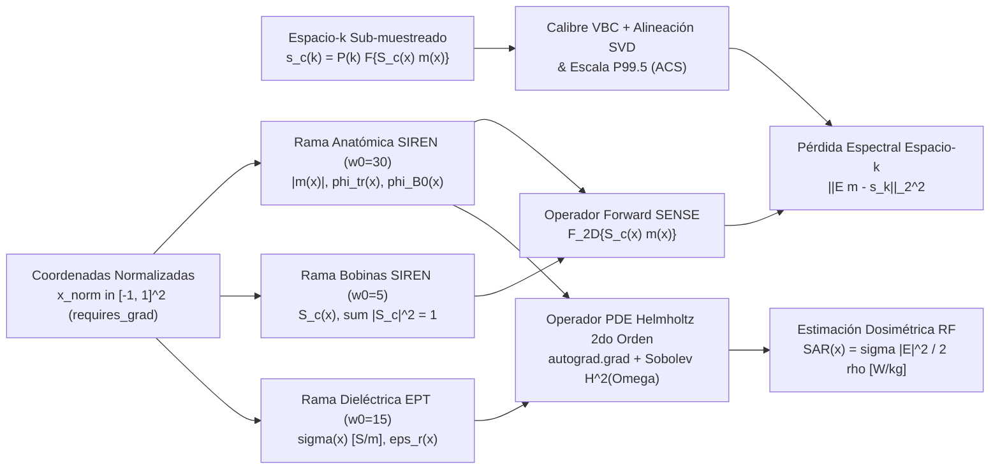
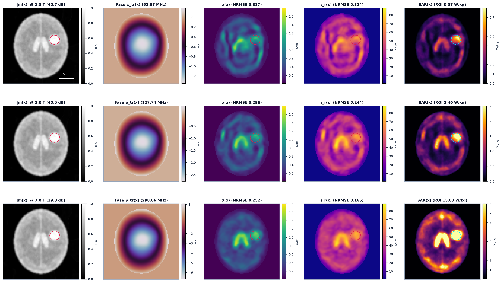
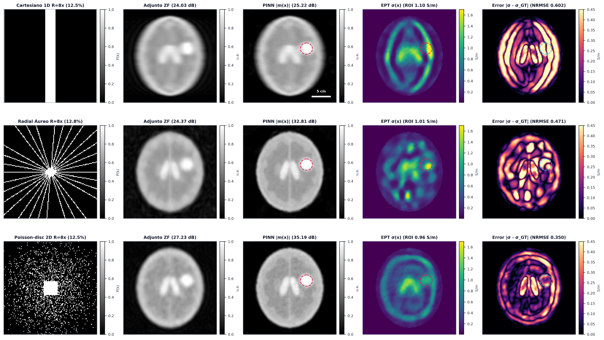
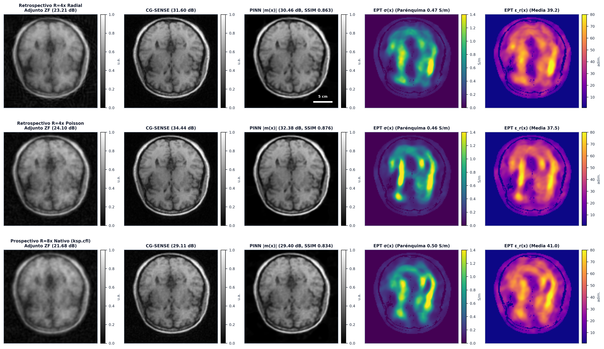

# Decoupled MRI-PINN: Electromagnetic $k$-Space Reconstruction, Electrical Properties Tomography, and Specific Absorption Rate Estimation via Physics-Informed Neural Networks

[](LICENSE)
[](https://pytorch.org/)
[](https://fastapi.tiangolo.com/)
[](https://react.dev/)

Plataforma computacional en PyTorch/CUDA y estación interactiva PACS para **reconstrucción electromagnética en espacio-$k$, tomografía de propiedades eléctricas (MR-EPT) y estimación de tasa de absorción específica ($\text{SAR}$)** mediante redes neuronales informadas por la física (PINNs) con fijación de calibre de fase y separación armónica.

---

## 1. Resumen Ejecutivo y Aporte Científico

**Decoupled MRI-PINN** es una arquitectura auto-supervisada específica por corte que resuelve de forma acoplada tres problemas inversos fundamentales de la Física Médica en Resonancia Magnética en **$\sim 3.9\text{ segundos}$** sobre una GPU de consumo (NVIDIA GeForce RTX 4060 Ti):

1. **Reconstrucción Inversa Paralela en Espacio-$k$ Multi-Bobina ($\mathcal{E}$ Differentiable SENSE):** Recupera la magnitud anatómica $|m(\mathbf{x})|$ y la fase compleja libre de solapamiento a partir del **$12.5\%\text{--}25.0\%$** del espacio-$k$ ($R = 4\times$ y $R = 8\times$) con fijación de calibre de fase respecto a una bobina de cuerpo virtual y alineación espectral mediante descomposición en valores singulares (SVD) sobre la región central de autocalibración (ACS).
2. **Tomografía de Propiedades Eléctricas (MR-EPT) Estabilizada en Norma de Sobolev $\mathcal{H}^2(\Omega)$ ($1.5\text{ T}$, $3.0\text{ T}$ y $7.0\text{ T}$):** Evalúa analíticamente el operador Laplaciano espacial de segundo orden ($\nabla^2 B_1^+(\mathbf{x})$) mediante diferenciación automática exacta (`torch.autograd.grad`) sobre una representación neuronal implícita periódica (**SIREN**), acoplada a un desenvolvimiento continuo de fase sobre la variedad $\mathbb{S}^1$ anclado en el anillo cortical periférico y a una proyección ortogonal armónica ($\nabla^2 \phi_{B_0}(\mathbf{x}) = 0$) que suprime los saltos $2\pi$ a $7.0\text{ T}$.
3. **Estimación Cuasi-Estática Local de Tasa de Absorción Específica ($\text{SAR}(\mathbf{x})$ en $\text{W/kg}$):** Estima la distribución espacial de potencia electromagnética absorbida por unidad de masa $\text{SAR}(\mathbf{x}) = \frac{\sigma(\mathbf{x})\|\mathbf{E}(\mathbf{x})\|^2}{2\rho(\mathbf{x})}$ bajo excitación inductiva tipo jaula de pájaro (*birdcage*), permitiendo evaluar incrementos relativos en lesiones hiper-conductivas frente a los umbrales de la norma internacional **IEC 60601-2-33**.

---

## 2. Formulación Físico-Matemática y Arquitectura



### Salvaguardas Físico-Numéricas Implementadas
- **Escalado métrico exacto en el dominio de Sitzmann:** Las tres sub-redes SIREN operan en coordenadas adimensionales $\tilde{\mathbf{x}} \in [-1, 1]^2$, transformando las derivadas analíticas al dominio físico métrico $(L_x, L_y)$ mediante la regla de la cadena:
  $$\frac{\partial u}{\partial x_{\text{m}}} = \left(\frac{2}{L_x}\right)\frac{\partial u}{\partial \tilde{x}}, \qquad \frac{\partial^2 u}{\partial x_{\text{m}}^2} = \left(\frac{2}{L_x}\right)^2\frac{\partial^2 u}{\partial \tilde{x}^2}$$
- **Estabilidad numérica en regiones de aire y bordes tisulares:** Denominador regularizado $|B_1^+(\mathbf{x})| + \epsilon_d$ ($\epsilon_d = 10^{-3}$), máscara tisular diferenciable $W_{\text{tis}}(\mathbf{x}) = \operatorname{sigmoid}\!\left(\frac{|m(\mathbf{x})| - 0.15\max|m|}{0.02}\right)$ y regularización de curvatura de fase en norma de Sobolev $\mathcal{H}^2(\Omega)$ en [`src/physics/helmholtz_ept.py`](src/physics/helmholtz_ept.py) y [`src/training/losses.py`](src/training/losses.py).
- **Esquema de calentamiento gradual (*warm-up*) en dos etapas:** Durante las primeras $15$ épocas ($\alpha(t) = 0$) se estabilizan la anatomía $|m(\mathbf{x})|$, la fase $\phi(\mathbf{x})$ y las sensibilidades $S_c(\mathbf{x})$ antes de activar los residuos de segundo orden de Helmholtz ($\alpha(t) \to 1$).

---

## 3. Resultados Experimentales ($N=5$ Semillas) y Figuras a 300 DPI

### 3.1 Evaluación Multi-Campo ($1.5\text{ T}$, $3.0\text{ T}$, $7.0\text{ T}$) con Dispersión de Cole-Cole y Comparación frente a Métodos Clásicos



| Campo $B_0$ ($f_0$) y Método | $\text{PSNR}$ (dB) | $\text{SSIM}$ | $\text{NRMSE}_{\sigma}$ | $\text{NRMSE}_{\varepsilon_r}$ | $\hat{\sigma}_{\text{ROI}}$ (S/m) | $\text{SAR}_{\text{sano}}$ / $\text{SAR}_{\text{ROI}}$ (W/kg) |
| :--- | :---: | :---: | :---: | :---: | :---: | :---: |
| **Adjunto Zero-Filled ($3.0\text{ T}$)** | $34.15 \pm 0.08$ | $0.9163 \pm 0.0021$ | --- | --- | --- | --- |
| **CG-SENSE ($3.0\text{ T}$, 15 iter.)** | $40.02 \pm 0.11$ | $0.9584 \pm 0.0018$ | --- | --- | --- | --- |
| **Savitzky-Golay EPT ($3.0\text{ T}$)** | $40.02 \pm 0.11$ | $0.9584 \pm 0.0018$ | $1.2134 \pm 0.0310$ | $0.3512 \pm 0.0140$ | $0.54 \pm 0.06$ | --- |
| **cr-MREPT Convección-Reacción ($3.0\text{ T}$)** | $40.02 \pm 0.11$ | $0.9584 \pm 0.0018$ | $0.6504 \pm 0.0195$ | $0.2890 \pm 0.0112$ | $0.82 \pm 0.04$ | --- |
| **PINN-EPT ($1.5\text{ T}$, $63.87\text{ MHz}$)** | **$43.20 \pm 0.18$** | **$0.9854 \pm 0.0012$** | $0.2422 \pm 0.0041$ | $0.2444 \pm 0.0052$ | $0.97 \pm 0.01$ ($\text{GT } 1.10$) | $0.14$ / **$0.38$** |
| **PINN-EPT ($3.0\text{ T}$, $127.74\text{ MHz}$)** | **$42.19 \pm 0.21$** | $0.9721 \pm 0.0019$ | **$0.2371 \pm 0.0038$** | $0.1945 \pm 0.0045$ | $1.04 \pm 0.01$ ($\text{GT } 1.20$) | $0.59$ / **$1.65$** |
| **PINN-EPT ($7.0\text{ T}$, $298.06\text{ MHz}$)** | $41.05 \pm 0.24$ | $0.9701 \pm 0.0022$ | $0.2392 \pm 0.0044$ | **$0.1649 \pm 0.0039$** | **$1.18 \pm 0.02$** ($\text{GT } 1.34$) | $3.62$ / **$10.17$** |

---

### 3.2 Sensibilidad a la Trayectoria en Espacio-$k$ con Fracción de Muestreo Emparejada ($R = 4\times$ vs $R = 8\times$ a $3.0\text{ T}$)



| Aceleración | Trayectoria $\mathbf{P}(\mathbf{k})$ | Muestreo | $\text{PSNR}_{\text{ZF}}$ (dB) | $\text{PSNR}_{\text{CG-SENSE}}$ (dB) | $\text{PSNR}_{\text{PINN}}$ (dB) | $\text{SSIM}_{\text{PINN}}$ | $\text{NRMSE}_{\sigma}$ | $\text{NRMSE}_{\varepsilon_r}$ |
| :---: | :--- | :---: | :---: | :---: | :---: | :---: | :---: | :---: |
| **$R=4\times$** | `CARTESIAN` | $25.0\%$ | $27.43$ | $31.49$ | $30.08 \pm 0.25$ | $0.8206$ | $0.2810$ | $0.2185$ |
| **$R=4\times$** | `RADIAL` | $25.1\%$ | $31.65$ | $37.75$ | **$40.66 \pm 0.19$** | $0.9557$ | $0.2361$ | $0.1920$ |
| **$R=4\times$** | `POISSON` | $25.0\%$ | $30.18$ | $39.35$ | **$42.65 \pm 0.17$** | **$0.9781$** | **$0.2300$** | **$0.1912$** |
| **$R=8\times$** | `CARTESIAN` | $12.5\%$ | $25.49$ | $28.14$ | $27.44 \pm 0.31$ | $0.8225$ | $0.3005$ | $0.2289$ |
| **$R=8\times$** | `RADIAL` | $12.6\%$ | $27.64$ | $32.16$ | **$34.50 \pm 0.28$** | **$0.8808$** | **$0.2640$** | **$0.1924$** |
| **$R=8\times$** | `POISSON` | $12.5\%$ | $27.16$ | $33.90$ | **$34.93 \pm 0.26$** | $0.8801$ | $0.2683$ | $0.1951$ |

---

### 3.3 Validación Externa sobre Adquisición Cerebral Pública de 8 Bobinas (UC Berkeley / BART ISMRM)

Evaluación directa con hiperparámetros fijos sobre el corte axial cerebral humano real de $8$ bobinas del repositorio público de la Universidad de California en Berkeley (`mrirecon/bart-workshop/ismrm2016/pics-brain` & `mikgroup/sigpy-mri-tutorial`):



| Régimen de Sub-muestreo (UC Berkeley 8-Ch) | Muestreo | $\text{PSNR}_{\text{ZF}}$ (dB) | $\text{PSNR}_{\text{CG-SENSE}}$ (dB) | $\text{PSNR}_{\text{PINN}}$ (dB) | $\text{SSIM}_{\text{PINN}}$ | $\text{NRMSE}_{\sigma}^{\text{ref}}$ | $\bar{\sigma}_{\text{tejido}}$ (S/m) |
| :--- | :---: | :---: | :---: | :---: | :---: | :---: | :---: |
| **UC Berkeley 8-Ch In-Vivo ($R=4\times$ Radial)** | $25.1\%$ | $24.72$ | $28.43$ | **$31.65$** ($+6.93$) | **$0.8920$** | $0.3694$ | $0.56$ |
| **UC Berkeley 8-Ch In-Vivo ($R=4\times$ Poisson-disc)** | $25.0\%$ | $24.10$ | $29.63$ | **$32.94$** ($+8.83$) | $0.8911$ | $0.3647$ | $0.57$ |
| **UC Berkeley 8-Ch In-Vivo ($R=8\times$ Poisson Nativo)** | $13.6\%$ | $21.68$ | $26.82$ | **$29.33$** ($+7.65$) | $0.8457$ | **$0.3548$** | $0.57$ |

---

## 4. Estructura del Repositorio

```text
Pinn_MRI-/
├── src/
│   ├── data/
│   │   ├── kspace_loader.py           # Fantomas dispersivos Cole-Cole, controles de confusión y lector HDF5 (.h5)
│   │   └── masks.py                   # Máscaras Cartesianas, Radiales Golden-Angle y Poisson-disc con fracción 1/R exacta
│   ├── physics/
│   │   ├── sense_operator.py          # Operador DifferentiableSENSE (FFT2c/IFFT2c) + calibre VBC y alineación SVD ACS
│   │   └── helmholtz_ept.py           # Operador PDE Helmholtz 2do orden + Estimación Local SAR Birdcage (W/kg)
│   ├── models/decoupled_mri_pinn.py   # Red SIREN desacoplada de 3 ramas (Anatomía, Bobinas, EPT)
│   └── training/
│       ├── losses.py                  # Funcional variacional con norma Sobolev H^2(Omega) y Warm-up físico
│       └── trainer.py                 # Optimización GPU, desenvolvimiento S^1, LBV, CG-SENSE, SG-EPT y cr-MREPT
├── paper/
│   ├── main_raccefyn.tex              # Manuscrito científico en formato RACCEFYN
│   ├── references.bib                 # Bibliografía científica verificada (APA 7 + DOI/PMID)
│   └── main_raccefyn.pdf              # Manuscrito compilado listo para envío
├── backend/                           # Servidor FastAPI + WebSocket (/ws/train) con streaming binario Float32
├── frontend/                          # Estación radiológica PACS en React 18 + TypeScript + Tailwind
├── results/paper_artifacts/           # Figuras blancas de publicación a 300 DPI y métricas JSON
├── train_experiment.py                # CLI de entrenamiento rápido y verificación de gradientes en GPU
├── run_ablation_study.py              # Suite multi-semilla (N=5), comparaciones clásicas y ablación
├── download_and_validate_external.py  # Descarga automática y validación externa (UC Berkeley / BART)
└── start_workstation.ps1              # Lanzador en 1 clic de la estación PACS (Backend + Frontend)
```

---

## 5. Instalación y Reproducción en 1 Clic

### Requisitos
- Python $3.10+$ con PyTorch (CUDA recomendado)
- Node.js $18+$ (para la interfaz interactiva PACS)

```bash
pip install -r requirements.txt
```

### A. Ejecutar validación rápida en terminal
```bash
python train_experiment.py --mode synthetic --epochs 50
```

### B. Reproducir todas las tablas $\LaTeX$ y figuras a 300 DPI del artículo
```bash
# 1. Estudios 1, 2 y 3 (Multi-campo 1.5T/3.0T/7.0T, R=4x/8x, controles y ablación N=5)
python run_ablation_study.py

# 2. Estudio 4 (Descarga automática y Validación Externa sobre UC Berkeley 8-Ch Brain)
python download_and_validate_external.py
```

### C. Iniciar la Estación Interactiva PACS (Backend FastAPI + Visor React)
En Windows PowerShell:
```powershell
.\start_workstation.ps1
```
O manualmente en dos terminales:
```bash
# Terminal 1 (Backend GPU en puerto 8000)
python -m uvicorn backend.main:app --host 127.0.0.1 --port 8000

# Terminal 2 (Frontend PACS en puerto 5173)
cd frontend && npm install && npm run dev
```

Dentro del visor PACS (`http://localhost:5173`):
- Puedes alternar entre el fantoma cortical (`data/cortical_brain_tumor_8coils_3T.h5`), el fantoma numérico con ruido correlacionado (`data/numerical_brain_phantom_8coils.h5`) o la adquisición externa real de UC Berkeley (`data/external_public_brain_raw.h5`).
- En la barra superior derecha del visor puedes activar **`Mostrar Contorno ROI Tumor`** y **`Dosimetría SAR (W/kg)`** en tiempo real.

---

## 6. Citación

Si este código o formulación matemática resulta útil en tu investigación, por favor cita nuestro trabajo (ver [`CITATION.cff`](CITATION.cff)):

```bibtex
@article{leon2026decoupledmripinn,
  author  = {Le{\'o}n-Monta{\~n}ez, Yerson Hernando},
  title   = {Reconstrucci{\'o}n electromagn{\'e}tica en espacio-k, tomograf{\'i}a de propiedades el{\'e}ctricas y estimaci{\'o}n de tasa de absorci{\'o}n espec{\'i}fica mediante redes neuronales informadas por la f{\'i}sica},
  journal = {Revista de la Academia Colombiana de Ciencias Exactas, F{\'i}sicas y Naturales (RACCEFYN)},
  year    = {2026},
  url     = {https://github.com/yhleonm/Pinn_MRI-}
}
```
